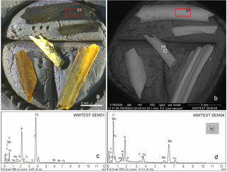

::: {.discovery-meta}
**Region / 地区**  
South Africa / 南非

**Date / 年代**  
Early Pleistocene · ca. 1.7–1.8 Ma / 早更新世 · 约170–180万年前

**Research / excavation institutions / 发掘或研究机构**  
Wonderwerk Cave Research Project; University of Toronto; Museo Nacional de Ciencias Naturales–CSIC; Hebrew University of Jerusalem; UNS–CONICET, Argentina

**Lead researchers / 主要负责人**  
Michael Chazan; Yolanda Fernández-Jalvo; M. Dolores Marin-Monfort

**Evidence status / 证据状态**  
English: English: English: English: English: English: Peer-reviewed specialist journal (B); important new method and early-fire evidence, but the age should be expressed as a range.  
中文：同行评议专业期刊研究（B级）；提供重要的新方法和早期用火证据，但年代应以区间表达。
中文：同行评议专业期刊研究（B级）；提供重要的新方法和早期用火证据，但年代应以区间表达。
中文：同行评议专业期刊研究（B级）；提供重要的新方法和早期用火证据，但年代应以区间表达。
中文：同行评议专业期刊研究（B级）；提供重要的新方法和早期用火证据，但年代应以区间表达。
中文：同行评议专业期刊研究（B级）；提供重要的新方法和早期用火证据，但年代应以区间表达。
中文：同行评议专业期刊研究（B级）；提供重要的新方法和早期用火证据，但年代应以区间表达。

**CCTV status / 央视遴选状态**  
CCTV candidate / 央视候选
:::

## 主要学术背景 | Scholarly background

**中文。** 人类何时开始利用火，是早期人属行为演化的核心问题。火与食物加工、夜间活动、捕食者防御、营地组织以及“烹饪假说”所讨论的能量收益密切相关，但百万年以上的燃烧痕迹极难区分自然火、次生搬运与真正的人类用火。Wonderwerk Cave的特殊价值在于燃烧证据位于距古洞口约30米的洞内原位堆积中，而且同一遗址约100万年前层位早已有多种燃烧指标，因此它提供了罕见的长时段比较序列。

**English.** The timing of fire use is central to debates about the behavioural evolution of early Homo because fire potentially affected food processing, activity schedules, predator protection, camp organization, and energetic models such as the cooking hypothesis. Evidence older than one million years is especially difficult to interpret because natural wildfire, redeposition, and anthropogenic burning can be hard to distinguish. Wonderwerk Cave is unusually important because the burning occurs deep inside an in-situ cave sequence, about 30 m from the palaeo-entrance, and can be compared with the site's already well-established ~1 Ma fire evidence.

## 主要发现 | Major findings

**中文。** 研究者在Wonderwerk Cave更深层沉积中识别出受热的微小动物骨骼，并结合骨骼发光性质与FTIR验证受热状态，将洞穴内古人类用火证据推进到更早的早更新世层位。论文给出的地层年代窗口约为107万–179万年前，研究者倾向其接近170万–180万年前。

**English.** Researchers identified heat-altered microfaunal bones in deeper deposits at Wonderwerk Cave and combined luminescence-based screening with FTIR confirmation, placing the relevant Stratum 11 burning within a 1.79–1.07 million-year age window; the excavators favour an age near 1.7–1.8 million years.

## 学术重要性 | Intellectual significance

**中文。** 其意义并不只是刷新“最早纪录”。人类何时开始稳定利用火，关系到营地组织、食物加工、昼夜活动、捕食风险和社会交往。该发现提示火可能在早期Homo erectus行为生态中已经发挥作用。不过，它支持的是“用火”而不是已经掌握“人工取火”。

**English.** The importance is not simply an earlier record. The timing of habitual fire use bears on food processing, camp organization, activity schedules, predator avoidance, and social interaction. The evidence suggests that fire already mattered within the behavioral ecology of early Homo erectus, while not demonstrating deliberate fire-making.

## 学术出版物 | Academic publications

Marin-Monfort, M. D., Shaw, C. L., Natalio, F., Grossman, L., Andrews, P., Campos, J., García-Morato, S., Pereira, J. M., Pons, A., Chazan, M., Horwitz, L. K., & Fernández-Jalvo, Y. (2026). New evidence for Early Pleistocene use of fire at Wonderwerk Cave (South Africa). PLOS One, 21(6), e0347480. https://doi.org/10.1371/journal.pone.0347480

**开放获取状态 | Open-access status.** 开放获取，CC BY 4.0；单幅图仍需检查第三方署名。 / Open access, CC BY 4.0; individual figure credits are still checked.

**出版物内容（中文）。** 文章提出以骨骼发光性质快速筛查受热微型骨骼，并用FTIR交叉验证，在Wonderwerk Cave早更新世地层中识别新的用火证据。它的贡献同时包括方法创新和年代推进，但论文支持的是早期人群利用并维持火，而不是证明已经掌握人工取火。

**What the publication shows (English).** The paper introduces bone luminescence as a rapid screening method for heat-altered microfaunal remains, validated against FTIR, and applies it to Early Pleistocene deposits at Wonderwerk Cave. Its contribution is both methodological and chronological, but the evidence supports the use and maintenance of fire rather than demonstrating deliberate fire-making.

<!-- APA-V2.1 -->

## 主要媒体报道 | Major media coverage

- [Smithsonian Magazine](https://www.smithsonianmag.com/smart-news/early-humans-may-have-used-fire-1-8-million-years-ago-nearly-doubling-the-age-of-the-oldest-known-evidence-for-the-feat-180989015/)
- [Science News — “We’ve had fire for longer than we thought”](https://www.sciencenews.org/article/hominids-had-fire-longer-than-thought)
- [Archaeology Magazine](https://archaeology.org/news/2026/06/26/traces-of-homo-erectus-fire-use-dated-to-1-8-million-years-ago/)

## 关键图像与许可 | Key images and permissions

**中文。** 下列图像来自已核查许可的学术出版物；图注同时标明来源、作者、许可与原文链接。若单幅图含第三方版权材料，自动抓取程序会跳过该图并改用原图链接。

**English.** The images below come from scholarly publications with verified reuse licences. Each caption records the source, author, licence and original link. If an individual figure contains third-party rights language, the automated fetcher skips it and the page falls back to a source-image link.

## 页面图像 | Page images

<a href="https://journals.plos.org/plosone/article?id=10.1371/journal.pone.0347480" target="_blank">View original image / 查看原图 →</a>

图1—受热、未受热与氟化骨骼的发光与FTIR比较 / Figure 1—Luminescence and FTIR comparison of heated, unheated and fluorinated bone / Figure 1—Luminescence and FTIR comparison of heated, unheated and fluorinated bone / Figure 1—Luminescence and FTIR comparison of heated, unheated and fluorinated bone / Figure 1—Luminescence and FTIR comparison of heated, unheated and fluorinated bone / Figure 1—Luminescence and FTIR comparison of heated, unheated and fluorinated bone / Figure 1—Luminescence and FTIR comparison of heated, unheated and fluorinated bone—来源 Source：PLOS ONE—作者 Author：Marin-Monfort et al. 2026—许可 Licence：CC BY 4.0—<a href="https://journals.plos.org/plosone/article?id=10.1371/journal.pone.0347480" target="_blank">原文链接 Original</a>

<a href="https://journals.plos.org/plosone/article?id=10.1371/journal.pone.0347480" target="_blank">View original image / 查看原图 →</a>

图2—Wonderwerk Cave各发掘方格烧骨比例 / Figure 2—Proportions of burnt bone across Wonderwerk Cave excavation squares / Figure 2—Proportions of burnt bone across Wonderwerk Cave excavation squares / Figure 2—Proportions of burnt bone across Wonderwerk Cave excavation squares / Figure 2—Proportions of burnt bone across Wonderwerk Cave excavation squares / Figure 2—Proportions of burnt bone across Wonderwerk Cave excavation squares / Figure 2—Proportions of burnt bone across Wonderwerk Cave excavation squares—来源 Source：PLOS ONE—作者 Author：Marin-Monfort et al. 2026—许可 Licence：CC BY 4.0—<a href="https://journals.plos.org/plosone/article?id=10.1371/journal.pone.0347480" target="_blank">原文链接 Original</a>

<a href="https://journals.plos.org/plosone/article?id=10.1371/journal.pone.0347480" target="_blank">View original image / 查看原图 →</a>

图3—早更新世烧骨证据的分析图版 / Figure 3—Analytical evidence for Early Pleistocene burnt bone / Figure 3—Analytical evidence for Early Pleistocene burnt bone / Figure 3—Analytical evidence for Early Pleistocene burnt bone / Figure 3—Analytical evidence for Early Pleistocene burnt bone / Figure 3—Analytical evidence for Early Pleistocene burnt bone / Figure 3—Analytical evidence for Early Pleistocene burnt bone—来源 Source：PLOS ONE—作者 Author：Marin-Monfort et al. 2026—许可 Licence：CC BY 4.0—<a href="https://journals.plos.org/plosone/article?id=10.1371/journal.pone.0347480" target="_blank">原文链接 Original</a>

## 图像与图版来源 | Images and figure sources

- [Archaeology Magazine report and excavation imagery](https://archaeology.org/news/2026/06/26/traces-of-homo-erectus-fire-use-dated-to-1-8-million-years-ago/)

::: {.callout-note title="Image policy / 图像说明"}
本站优先链接论文原始图版、开放获取图像和媒体原始报道。只有在版权或再利用条件明确时，图片文件才会复制到本仓库。  
The site prioritizes original publication figures, open-access images, and source media pages. Image files are copied into this repository only when reuse terms are clear.
:::
