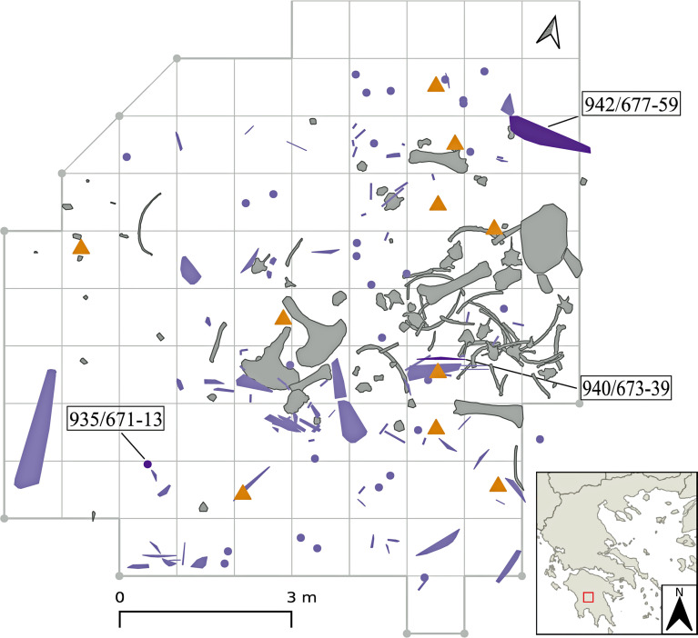
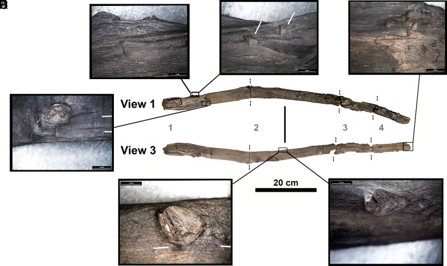
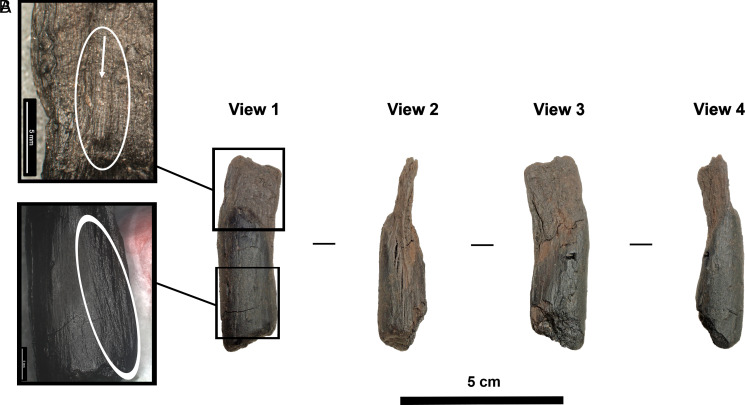

::: {.discovery-meta}
**Region / 地区**  
Peloponnese, Greece / 希腊伯罗奔尼撒

**Date / 年代**  
Middle Pleistocene · ca. 430 ka / 中更新世 · 约43万年前

**Research / excavation institutions / 发掘或研究机构**  
University of Reading; University of Tübingen; American School of Classical Studies at Athens; Aristotle University of Thessaloniki; Hellenic Ministry of Culture; University of Ioannina

**Lead researchers / 主要负责人**  
Annemieke Milks; Katerina Harvati; Eleni Panagopoulou; Vangelis Tourloukis; Panagiotis Karkanas

**Evidence status / 证据状态**  
English: Top-tier peer-reviewed research (A).  
中文：顶级同行评议研究（A级）。

**CCTV status / 央视遴选状态**  
CCTV candidate / 央视候选
:::

## 主要学术背景 | Scholarly background

**中文。** 旧石器时代被称为“石器时代”，很大程度上源于保存偏差：木、纤维、皮革和植物性材料通常消失。舍宁根木矛、Clacton木矛尖和卡兰博瀑布木结构已经说明中更新世人类广泛利用木材，但真正保存下来的手持木工具仍极少。Marathousa 1的意义因此不是“木材第一次出现”，而是把可操作、可携带的日常木工具带入约43万年前的技术系统。

**English.** The label “Stone Age” is partly a preservation artefact: wood, fibre, hide, and other organic technologies usually disappear. Finds such as the Schöningen spears, the Clacton spear point, and Kalambo Falls structures already show that Middle Pleistocene hominins worked wood. What makes Marathousa 1 exceptional is the preservation of handheld implements that broaden the reconstructed everyday technological repertoire.

## 主要发现 | Major findings

**中文。** 伯罗奔尼撒Megalopolis盆地遗址出土两件具有明确加工与使用痕迹的木制品，其中一件为桤木，另一件可能为柳木或杨木。

**English.** Two worked wooden objects with clear traces of manufacture and use were recovered from the Megalopolis Basin in the Peloponnese, including alder and probable willow or poplar.

## 学术重要性 | Intellectual significance

**中文。** 旧石器时代常被理解为“石器时代”，很大程度上是保存偏差造成的。木材、纤维和皮革等有机技术通常不会保存。这批木器说明中更新世技术系统远比单纯石器组合更丰富，也强化了对早期人类木工、采集和日常工具系统的重新评估。

**English.** The apparent dominance of stone in Palaeolithic technology is strongly shaped by preservation bias. Wood, fiber, and hide rarely survive. These finds show that Middle Pleistocene technological systems were more diverse than lithic assemblages alone suggest and invite a broader reconstruction of woodworking and everyday toolkits.

## 学术出版物 | Academic publications

Milks, A., Ntinou, M., Koutalis, S., Michailidis, D., Konidaris, G. E., Giusti, D., Thompson, N., Tsartsidou, G., Panagopoulou, E., Tourloukis, V., Karkanas, P., & Harvati, K. (2026). Evidence for the earliest hominin use of wooden handheld tools found at Marathousa 1 (Greece). Proceedings of the National Academy of Sciences, 123(6). https://doi.org/10.1073/pnas.2515479123

**开放获取状态 | Open-access status.** 开放获取，CC BY-NC-ND 4.0；原图仅按许可原样使用。 / Open access, CC BY-NC-ND 4.0; figures are used unmodified under the licence.

**出版物内容（中文）。** 文章系统分析 Marathousa 1 的 144 件木质遗存，确认一件约81厘米长的桤木手持工具和一件较小的柳/杨木工具具有人工制作和使用痕迹。研究不仅把可确认的手持木器推到约43万年前，也说明中更新世技术系统不能仅依据石器来重建。

**What the publication shows (English).** The paper systematically analyses 144 wooden remains from Marathousa 1 and identifies an approximately 81-cm alder implement and a smaller willow/poplar tool with anthropogenic manufacture and use traces. It both extends the record of securely identified handheld wooden tools to about 430 ka and demonstrates why Middle Pleistocene technology cannot be reconstructed from lithics alone.

<!-- APA-V2.1 -->

## 主要媒体报道 | Major media coverage

- [The New York Times (syndicated via eKathimerini)](https://www.ekathimerini.com/nytimes/1293855/)
- [BBC report](https://www.bbc.co.uk/newsround/articles/cn0yp4g0ek4o)
- [Archaeology Magazine](https://archaeology.org/issues/online/digs-discoveries/turning-over-the-soil/)
- [University of Reading](https://www.reading.ac.uk/news/2026/Research-News/Earliest-evidence-of-wooden-tools-used-by-humans)
- [PNAS / PMC full article](https://pmc.ncbi.nlm.nih.gov/articles/PMC12890827/)

## 关键图像与许可 | Key images and permissions

**中文。** 下列图像来自已核查许可的学术出版物；图注同时标明来源、作者、许可与原文链接。若单幅图含第三方版权材料，自动抓取程序会跳过该图并改用原图链接。

**English.** The images below come from scholarly publications with verified reuse licences. Each caption records the source, author, licence and original link. If an individual figure contains third-party rights language, the automated fetcher skips it and the page falls back to a source-image link.

## 页面图像 | Page images

<a href="https://pmc.ncbi.nlm.nih.gov/articles/PMC12890827/" target="_blank">View original image / 查看原图 →</a>

图1—Marathousa 1遗址与木器发现背景 / Figure 1—Marathousa 1 site and wooden-tool context—来源 Source：PNAS—作者 Author：Milks et al. 2026—许可 Licence：CC BY-NC-ND 4.0（原图不改动）—<a href="https://pmc.ncbi.nlm.nih.gov/articles/PMC12890827/" target="_blank">原文链接 Original</a>

<a href="https://pmc.ncbi.nlm.nih.gov/articles/PMC12890827/" target="_blank">View original image / 查看原图 →</a>

图2—43万年前木制手持工具及加工痕迹 / Figure 2—Handheld wooden tools and modification traces from about 430 ka—来源 Source：PNAS—作者 Author：Milks et al. 2026—许可 Licence：CC BY-NC-ND 4.0（原图不改动）—<a href="https://pmc.ncbi.nlm.nih.gov/articles/PMC12890827/" target="_blank">原文链接 Original</a>

<a href="https://pmc.ncbi.nlm.nih.gov/articles/PMC12890827/" target="_blank">View original image / 查看原图 →</a>

图3—木器使用痕迹与比较分析 / Figure 3—Use traces and comparative analysis of the wooden implements—来源 Source：PNAS—作者 Author：Milks et al. 2026—许可 Licence：CC BY-NC-ND 4.0（原图不改动）—<a href="https://pmc.ncbi.nlm.nih.gov/articles/PMC12890827/" target="_blank">原文链接 Original</a>

## 图像与图版来源 | Images and figure sources

- [Article figures (PMC)](https://pmc.ncbi.nlm.nih.gov/articles/PMC12890827/)

::: {.callout-note title="Image policy / 图像说明"}
本站优先链接论文原始图版、开放获取图像和媒体原始报道。只有在版权或再利用条件明确时，图片文件才会复制到本仓库。  
The site prioritizes original publication figures, open-access images, and source media pages. Image files are copied into this repository only when reuse terms are clear.
:::
