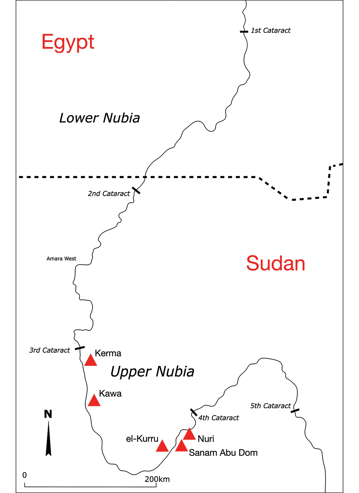
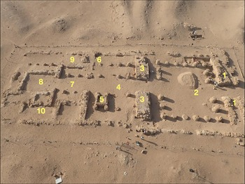
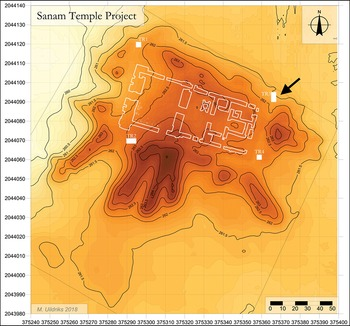

::: {.discovery-meta}
**Region / 地区**  
Napatan region, Sudan / 苏丹纳帕塔地区

**Date / 年代**  
7th c. BCE / 公元前7世纪

**Research / excavation institutions / 发掘或研究机构**  
Durham University; Institute of Fine Arts, New York University; National Corporation for Antiquities and Museums, Sudan

**Lead researchers / 主要负责人**  
Rennan Lemos; Kathryn Howley; Shadia Abdu Rabo; Siobhan Shinn

**Evidence status / 证据状态**  
English: English: English: English: English: Peer-reviewed specialist-journal research (B); first securely identified Middle Napatan faience-production workshop.  
中文：同行评议专业期刊研究（B级）；目前是可靠识别的纳帕塔中期费昂斯生产作坊。
中文：同行评议专业期刊研究（B级）；目前是可靠识别的纳帕塔中期费昂斯生产作坊。
中文：同行评议专业期刊研究（B级）；目前是可靠识别的纳帕塔中期费昂斯生产作坊。
中文：同行评议专业期刊研究（B级）；目前是可靠识别的纳帕塔中期费昂斯生产作坊。
中文：同行评议专业期刊研究（B级）；目前是可靠识别的纳帕塔中期费昂斯生产作坊。

**CCTV status / 央视遴选状态**  
CCTV candidate / 央视候选
:::

## 主要学术背景 | Scholarly background

**中文。** 库施王国研究长期受“埃及影响/模仿”框架支配，而近年的重点转向地方国家如何主动选择、重组和技术化外来文化形式。费昂斯尤其适合研究这一问题，因为它既是高可见度的精英材料，又需要专业配方、窑炉、原料和工匠知识。Sanam神庙中的作坊因而能够把“文化借鉴”转化为可观察的生产组织与政治经济问题。

**English.** Kushite studies have long been dominated by models of Egyptian influence or imitation. Recent work instead asks how local states selectively reworked imported forms through their own technologies and institutions. Faience is particularly revealing because it is both a visible prestige material and a craft requiring recipes, firing installations, raw materials, and specialist knowledge. The Sanam workshop therefore converts debates about cultural borrowing into questions of production organization and political economy.

## 主要发现 | Major findings

**中文。** Sanam神庙建筑群发现可靠的faience生产作坊，包括珠饰和沙布提俑生产证据，并显示当地工匠采用不同于埃及的材料配方。

**English.** A securely identified faience-production workshop at the Sanam temple complex preserves evidence for beads and shabti manufacture and for material recipes that differed from Egyptian practice.

## 学术重要性 | Intellectual significance

**中文。** 研究突破了把库施物质文化简单理解为“埃及模仿”的框架。更关键的是，神庙生产把贵重物品、原料、专业知识和劳动力组织联系到国家政治经济，提供讨论库施王权与生产控制的直接材料。

**English.** The study moves beyond viewing Kushite material culture as simple Egyptian imitation. More importantly, temple-based production connects prestige goods, raw materials, specialist knowledge, and labor organization to political economy and state power.

## 学术出版物 | Academic publications

Lemos, R., Howley, K., Shinn, S., & Abdu Rabo, S. (2026). Crafting power in Kush: faience production and state control in the Napatan region. Antiquity, 1–20. https://doi.org/10.15184/aqy.2026.10434

**出版物内容（中文）。** 文章通过 Sanam 神庙中的窑炉、模具、费昂斯珠、沙布提俑和生产废品，重建纳帕塔时期费昂斯生产体系。研究指出当地工匠使用与埃及不同的材料配方，并把神庙生产、专业知识与国家控制联系起来，从生产组织层面重新讨论库施与埃及的关系。

**What the publication shows (English).** Using kilns, moulds, faience beads, shabtis and production waste from Sanam Temple, the article reconstructs a Napatan faience-production system. It identifies local recipes that differed from Egyptian practice and links temple production, specialist knowledge and state control, reframing Kushite–Egyptian relations through production organization rather than imitation alone.

<!-- APA-V2.1 -->

## 主要媒体报道 | Major media coverage

- [Archaeology Magazine](https://archaeology.org/news/2026/10/20/faience-workshop-found-in-ancient-nubia/)
- [Phys.org](https://phys.org/news/2026-10-ancient-nubian-temple-faience-workshop.html)
- [Antiquity feature](https://antiquity.ac.uk/news/2026/uncovering-shimmering-material-helped-craft-power-ancient-nubia)

## 关键图像与许可 | Key images and permissions

**中文。** 下列图像来自已核查许可的学术出版物；图注同时标明来源、作者、许可与原文链接。若单幅图含第三方版权材料，自动抓取程序会跳过该图并改用原图链接。

**English.** The images below come from scholarly publications with verified reuse licences. Each caption records the source, author, licence and original link. If an individual figure contains third-party rights language, the automated fetcher skips it and the page falls back to a source-image link.

## 页面图像 | Page images

<a href="https://www.cambridge.org/core/journals/antiquity/article/crafting-power-in-kush-faience-production-and-state-control-in-the-napatan-region/A15CF88886CC39E3C6D4110DD58B94A5" target="_blank">View original image / 查看原图 →</a>

图1—Sanam神庙及费昂斯作坊位置 / Figure 1—Location of Sanam Temple and the faience workshop / Figure 1—Location of Sanam Temple and the faience workshop / Figure 1—Location of Sanam Temple and the faience workshop / Figure 1—Location of Sanam Temple and the faience workshop / Figure 1—Location of Sanam Temple and the faience workshop—来源 Source：Antiquity—作者 Author：Lemos et al. 2026—许可 Licence：CC BY 4.0—<a href="https://www.cambridge.org/core/journals/antiquity/article/crafting-power-in-kush-faience-production-and-state-control-in-the-napatan-region/A15CF88886CC39E3C6D4110DD58B94A5" target="_blank">原文链接 Original</a>

<a href="https://www.cambridge.org/core/journals/antiquity/article/crafting-power-in-kush-faience-production-and-state-control-in-the-napatan-region/A15CF88886CC39E3C6D4110DD58B94A5" target="_blank">View original image / 查看原图 →</a>

图2—神庙后部生产设施与作坊遗迹 / Figure 2—Production installations and workshop remains behind the temple / Figure 2—Production installations and workshop remains behind the temple / Figure 2—Production installations and workshop remains behind the temple / Figure 2—Production installations and workshop remains behind the temple / Figure 2—Production installations and workshop remains behind the temple—来源 Source：Antiquity—作者 Author：Lemos et al. 2026—许可 Licence：CC BY 4.0—<a href="https://www.cambridge.org/core/journals/antiquity/article/crafting-power-in-kush-faience-production-and-state-control-in-the-napatan-region/A15CF88886CC39E3C6D4110DD58B94A5" target="_blank">原文链接 Original</a>

<a href="https://www.cambridge.org/core/journals/antiquity/article/crafting-power-in-kush-faience-production-and-state-control-in-the-napatan-region/A15CF88886CC39E3C6D4110DD58B94A5" target="_blank">View original image / 查看原图 →</a>

图3—费昂斯珠、废品与生产证据 / Figure 3—Faience beads, wasters and production evidence / Figure 3—Faience beads, wasters and production evidence / Figure 3—Faience beads, wasters and production evidence / Figure 3—Faience beads, wasters and production evidence / Figure 3—Faience beads, wasters and production evidence—来源 Source：Antiquity—作者 Author：Lemos et al. 2026—许可 Licence：CC BY 4.0—<a href="https://www.cambridge.org/core/journals/antiquity/article/crafting-power-in-kush-faience-production-and-state-control-in-the-napatan-region/A15CF88886CC39E3C6D4110DD58B94A5" target="_blank">原文链接 Original</a>

## 图像与图版来源 | Images and figure sources

- [Antiquity article figures](https://www.cambridge.org/core/journals/antiquity/article/crafting-power-in-kush-faience-production-and-state-control-in-the-napatan-region/A15CF88886CC39E3C6D4110DD58B94A5)

::: {.callout-note title="Image policy / 图像说明"}
本站优先链接论文原始图版、开放获取图像和媒体原始报道。只有在版权或再利用条件明确时，图片文件才会复制到本仓库。  
The site prioritizes original publication figures, open-access images, and source media pages. Image files are copied into this repository only when reuse terms are clear.
:::
