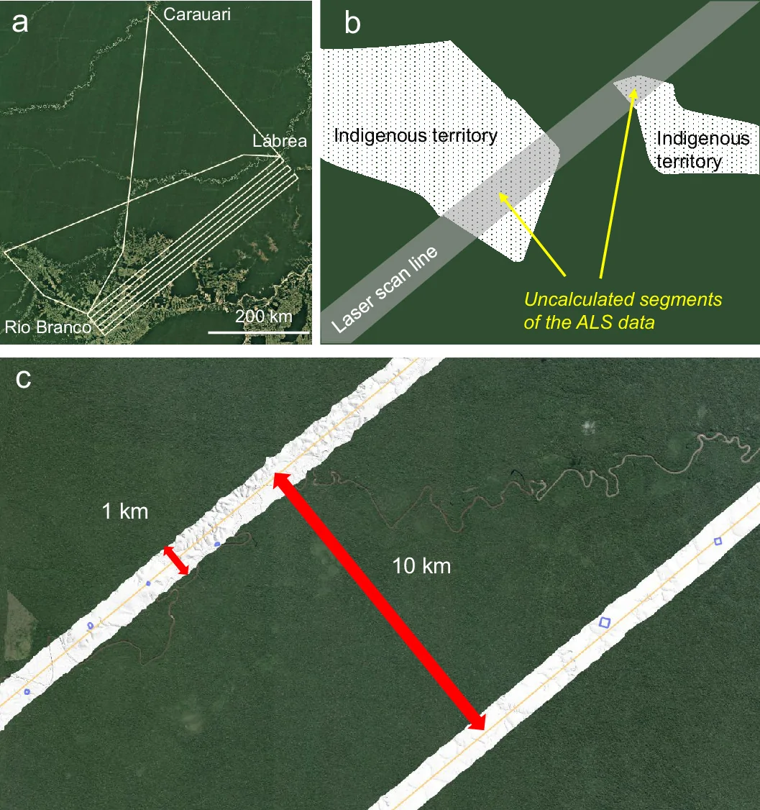
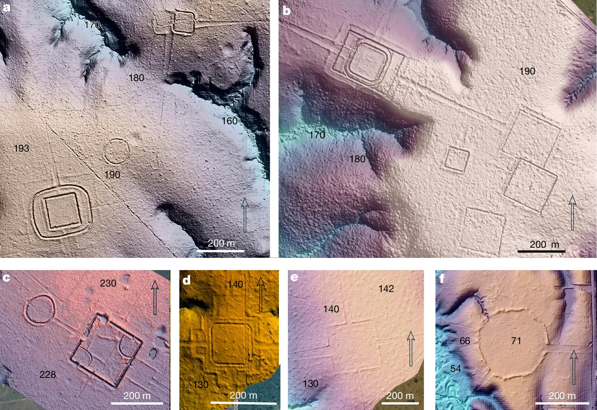
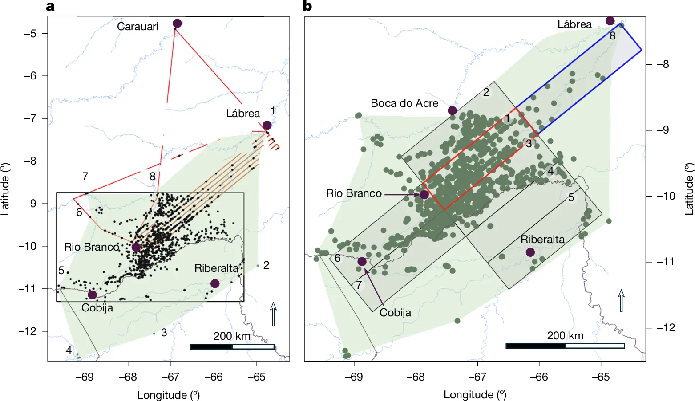

::: {.discovery-meta}
**Region / 地区**  
Southwestern Amazonia / 西南亚马孙

**Date / 年代**  
Precolonial Amazonia, especially ca. 100–300 CE / 前殖民时期，重点约公元100–300年

**Research / excavation institutions / 发掘或研究机构**  
University of Helsinki; University of Turku; Federal University of Acre; Finnish Geospatial Research Institute; Federal University of Pará and collaborating Indigenous/community researchers

**Lead researchers / 主要负责人**  
Martti Pärssinen; Risto Kalliola; Alceu Ranzi; Evandro Ferreira

**Evidence status / 证据状态**  
English: English: English: Top-tier peer-reviewed research (A); a major omitted candidate from the original CCTV list.  
中文：顶级同行评议研究（A级）；是原央视名单中明显遗漏的重要候选。
中文：顶级同行评议研究（A级）；是原央视名单中明显遗漏的重要候选。
中文：顶级同行评议研究（A级）；是原央视名单中明显遗漏的重要候选。

**CCTV status / 央视遴选状态**  
Additional candidate / 补充建议
:::

## 主要学术背景 | Scholarly background

**中文。** 亚马孙考古长期受“热带雨林承载不了高人口密度和复杂社会”的环境限制论影响。terra preta、几何土方工程、道路和大型聚落不断削弱这一模型，但森林覆盖使区域尺度估算一直困难。LiDAR的真正作用，是把零散可见遗迹转化为可估计的文化景观密度，从而重新讨论前殖民人口规模以及这些社会对森林、土壤和生物多样性的长期塑造。

**English.** Amazonian archaeology has long been shaped by environmental-limitation models that treated tropical forests as incapable of sustaining dense or complex societies. Terra preta, geometric earthworks, roads, and large settlements have steadily challenged that view, but canopy cover made regional estimates difficult. LiDAR changes the scale of inference by converting isolated visible sites into estimates of cultural-landscape density, reopening questions of precolonial population and long-term human effects on soils, forests, and biodiversity.

## 主要发现 | Major findings

**中文。** Aquiry及西南亚马孙研究利用约4430公里LiDAR航线与既有调查，新识别并统计大量土垣/几何土方工程；研究据此估算整个文化区可能存在约2.4万–3万处土方工程，并对公元100–300年前后人口规模作出125万–300万人的模型外推。后者应视为有争议的估计，而不是直接人口计数。

**English.** LiDAR survey and spatial modelling across southwestern Amazonia greatly expanded the known scale of geometric earthworks. The authors estimate roughly 24,000–30,000 earthworks across the broader cultural area and model a population of 1.25–3 million around AD 100–300; the population figure is an extrapolation and should be treated as such.

## 学术重要性 | Intellectual significance

**中文。** 这项研究触及亚马孙考古的百年核心问题：热带雨林究竟主要是“原始自然”，还是长期被人类塑造的文化景观。数万处土方工程意味着前殖民人口规模、聚落密度、土壤改造以及森林生态史都需要重新评估。

**English.** The study addresses a century-old question in Amazonian archaeology: whether tropical forests were mainly pristine environments or long-term cultural landscapes. Tens of thousands of earthworks imply substantial reassessment of precolonial population, settlement density, soil modification, and forest ecological history.

## 学术出版物 | Academic publications

Pärssinen, M., Kalliola, R., Ranzi, A., Puttonen, E., Lopes, R. C., Virtanen, P. K., Apurinã, F., Ruokolainen, K., Hyyppä, J., Kukko, A., Campos, M., de Novaes, F., Oinonen, M., Barbosa, A. D., Saunaluoma, S., & Ferreira, E. (2026). Over 20,000 precolonial earthworks in the Southwest Amazonia. Nature, 657(8131), 420–425. https://doi.org/10.1038/s41586-026-10835-7

**出版物内容（中文）。** 文章利用LiDAR调查和空间模型在西南亚马孙识别大量几何土方工程，并据此估算更广区域可能存在约2.4万—3万处前殖民土方遗迹。研究显著提高了对前殖民人口和土地利用强度的估计，但125万—300万人属于模型外推，应与直接考古计数区分。

**What the publication shows (English).** The study combines LiDAR survey and spatial modelling to identify large numbers of geometric earthworks in southwestern Amazonia and estimate roughly 24,000–30,000 precolonial earthworks across the broader cultural region. It substantially raises estimates of settlement and land-use intensity, although the proposed population of 1.25–3 million is a modelled extrapolation rather than a direct count.

<!-- APA-V2.1 -->

## 主要媒体报道 | Major media coverage

### 主要报道 | Major coverage

- [Smithsonian Magazine](https://www.smithsonianmag.com/smart-news/mysterious-shapes-hidden-beneath-the-amazon-canopy-reveal-a-sprawling-ancient-civilization-much-bigger-than-researchers-expected-180989236/)
- [Nature Portfolio press release](https://www.natureasia.com/en/info/press-releases/detail/9397)
- [Scientific American](https://www.scientificamerican.com/article/hundreds-of-ancient-never-before-seen-earthworks-discovered-in-the-amazon/)
- [Archaeology Magazine](https://archaeology.org/news/2026/07/31/hundreds-of-geoglyphs-discovered-in-amazon-rainforest/)
- [Nature Podcast](https://www.nature.com/articles/d41586-026-02367-x)

### 其他报道 | Additional coverage

- [Nature Research Briefing](https://www.nature.com/articles/d41586-026-02321-x)

## 关键图像与许可 | Key images and permissions

**中文。** 下列图像来自已核查许可的学术出版物；图注同时标明来源、作者、许可与原文链接。若单幅图含第三方版权材料，自动抓取程序会跳过该图并改用原图链接。

**English.** The images below come from scholarly publications with verified reuse licences. Each caption records the source, author, licence and original link. If an individual figure contains third-party rights language, the automated fetcher skips it and the page falls back to a source-image link.

## 页面图像 | Page images

<a href="https://www.nature.com/articles/s41586-026-10835-7" target="_blank">View original image / 查看原图 →</a>

图1—西南亚马孙Aquiry土方工程区域分布 / Figure 1—Regional distribution of Aquiry earthworks in southwestern Amazonia / Figure 1—Regional distribution of Aquiry earthworks in southwestern Amazonia / Figure 1—Regional distribution of Aquiry earthworks in southwestern Amazonia—来源 Source：Nature—作者 Author：Pärssinen et al. 2026—许可 Licence：CC BY 4.0—<a href="https://www.nature.com/articles/s41586-026-10835-7" target="_blank">原文链接 Original</a>

<a href="https://www.nature.com/articles/s41586-026-10835-7" target="_blank">View original image / 查看原图 →</a>

图2—LiDAR揭示的几何土方工程 / Figure 2—Geometric earthworks revealed by LiDAR / Figure 2—Geometric earthworks revealed by LiDAR / Figure 2—Geometric earthworks revealed by LiDAR—来源 Source：Nature—作者 Author：Pärssinen et al. 2026—许可 Licence：CC BY 4.0—<a href="https://www.nature.com/articles/s41586-026-10835-7" target="_blank">原文链接 Original</a>

<a href="https://www.nature.com/articles/s41586-026-10835-7" target="_blank">View original image / 查看原图 →</a>

图3—土方工程密度与区域尺度模型 / Figure 3—Earthwork density and regional-scale modelling / Figure 3—Earthwork density and regional-scale modelling / Figure 3—Earthwork density and regional-scale modelling—来源 Source：Nature—作者 Author：Pärssinen et al. 2026—许可 Licence：CC BY 4.0—<a href="https://www.nature.com/articles/s41586-026-10835-7" target="_blank">原文链接 Original</a>

## 图像与图版来源 | Images and figure sources

- [Nature article figures](https://www.nature.com/articles/s41586-026-10835-7)

::: {.callout-note title="Image policy / 图像说明"}
本站优先链接论文原始图版、开放获取图像和媒体原始报道。只有在版权或再利用条件明确时，图片文件才会复制到本仓库。  
The site prioritizes original publication figures, open-access images, and source media pages. Image files are copied into this repository only when reuse terms are clear.
:::
